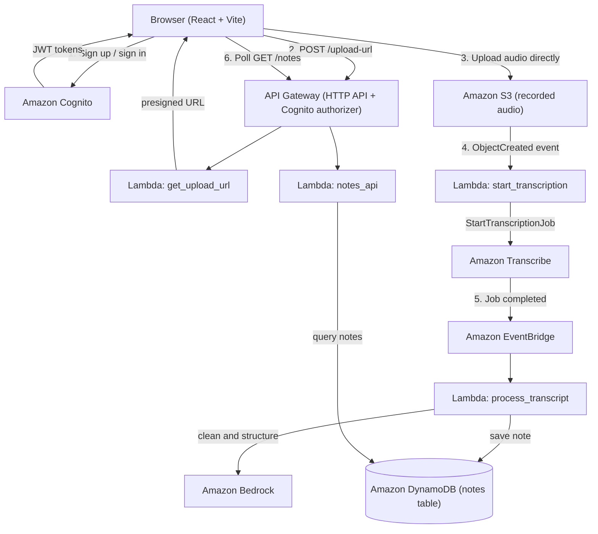

WTC-LXSJVS27


# VoiceToNote

VoiceToNote is a serverless voice-notes application. You record a short voice
note in the browser, and the app transcribes it, cleans it up with an AI model,
and saves it as a structured note with a title, summary, cleaned transcript and
a checklist of tasks. Notes are sorted into **Planned** and **Done**.

The project has a React frontend and a fully serverless AWS backend. Both parts
are in this repository.

---

## What the app does

- Create an account and sign in with email and password (Amazon Cognito).
- Record audio in the browser using the microphone.
- Upload the recording directly to Amazon S3.
- Transcribe the audio with Amazon Transcribe.
- Clean and structure the text with Amazon Bedrock (AI).
- Save notes in Amazon DynamoDB.
- View, search, edit and delete notes.
- Tick off tasks; a note moves to Done when all its tasks are complete.
- Works on desktop and mobile, with light and dark themes.

---

## Architecture



The AI processing runs asynchronously. The browser uploads the audio and then
polls the API until the finished note appears, usually within a few seconds.

---

## Frontend

The frontend is a React single-page application built with Vite and TypeScript.
It handles authentication, recording, uploading, and the notes interface.

Main parts:

- **Pages**: Login, Sign up, Notes board, Note detail.
- **Components**: voice recorder, note card, processing placeholder, search bar,
  delete confirmation modal, protected route.
- **Context**: authentication state and theme state.
- **Services**: Cognito calls, API calls, and the local notes cache.
- **Recording**: browser `MediaRecorder` API, saved as `audio/webm`.
- **Storage**: authentication tokens and a notes cache are kept in
  `localStorage` so the app loads instantly and survives a refresh.
- **Token handling**: expired tokens are refreshed automatically; a failed
  request is retried once.

Frontend folder: `frontend/VoiceToNote/`

```
frontend/VoiceToNote/
  src/
    Pages/          LoginPage, SignupPage, NotesPage, NotesDetail
    Components/     VoiceRec, NoteCard, ProcessingCard, SearchBar,
                    ConfirmModal, ProtectedRoute
    context/        AuthContext, ThemeContext
    services/       cognitoAuth, api, notesCache
    App.tsx         routes and providers
    main.tsx        app entry point
  public/
  index.html
  vite.config.ts
  package.json
```

---

## Backend

The backend is defined as infrastructure as code with AWS SAM
(`template.yaml`) and runs on AWS Lambda using Python 3.12 (ARM64).

The four Lambda functions:

| Function | Trigger | Purpose |
| --- | --- | --- |
| `get_upload_url` | `POST /upload-url` | Reads the user ID from the JWT and returns a presigned S3 upload URL. |
| `start_transcription` | S3 `ObjectCreated` | Starts an Amazon Transcribe job for the uploaded audio. |
| `process_transcript` | EventBridge (Transcribe job completed) | Downloads the transcript, cleans and structures it with Bedrock, and saves the note to DynamoDB. |
| `notes_api` | `GET/PUT/DELETE /notes` | Lists, reads, updates and deletes notes for the signed-in user. |

Backend folder: `backend/src/`

```
backend/src/
  get_upload_url.py
  start_transcription.py
  process_transcript.py
  notes_api.py
  ai_notes.py           shared Bedrock prompt and response parsing
```

`process_transcript.py` and `notes_api.py` both use `ai_notes.py`, so the AI
prompt and JSON parsing live in one place.

Other backend files:

```
template.yaml         AWS SAM template (all infrastructure)
samconfig.toml        SAM deployment settings
```

### AWS services used

| Service | Role |
| --- | --- |
| Amazon Cognito | User accounts, email verification, sign in, JWT tokens |
| Amazon API Gateway | HTTP API with a Cognito JWT authorizer |
| AWS Lambda | All backend logic |
| Amazon S3 | Stores recorded audio; audio expires after 7 days |
| Amazon Transcribe | Converts speech to text |
| Amazon EventBridge | Triggers processing when a transcription finishes |
| Amazon Bedrock | Cleans and structures the transcript with an AI model |
| Amazon DynamoDB | Stores notes (on-demand, no idle cost) |
| AWS CloudFormation / SAM | Deploys and manages the backend |

Default region is `af-south-1`. The Bedrock model used by the code is
`amazon.nova-micro-v1:0`, which is called in `us-east-1` because it is not
available in `af-south-1`.

---

## API endpoints

All routes require a valid Cognito token in the `Authorization: Bearer` header.

| Method | Path | Description |
| --- | --- | --- |
| POST | `/upload-url` | Get a presigned S3 upload URL and a new note ID. |
| GET | `/notes` | List all notes for the signed-in user. |
| GET | `/notes/{id}` | Get one note. |
| PUT | `/notes/{id}` | Update a note (text, status or tasks). Editing the text re-runs the AI structuring. |
| DELETE | `/notes/{id}` | Delete a note. |

---

## Prerequisites

- Node.js 20 or newer
- Python 3.12 (installed and managed by SAM for Lambda)
- AWS CLI configured with credentials (`aws configure`)
- AWS SAM CLI (`sam --version`)
- An AWS account with permission to create the services above
- Amazon Bedrock model access enabled for `amazon.nova-micro-v1:0` in
  `us-east-1`

---

## How to run the project

### 1. Deploy the backend

Run these commands from the repository root:

```bash
sam build
sam deploy --guided
```

During the guided deploy, use the settings already in `samconfig.toml` or accept
the prompts. The stack name is `voice-to-note` and the default region is
`af-south-1`.

When deployment finishes, print the stack outputs:

```bash
aws cloudformation describe-stacks \
  --stack-name voice-to-note \
  --region af-south-1 \
  --query "Stacks[0].Outputs" \
  --output table
```

The frontend needs `ApiUrl`, `UserPoolId` and `UserPoolClientId`.
`AudioBucketName` is used during cleanup.

### 2. Configure the frontend

Move into the frontend, install dependencies, and write the `.env` file from the
deployed stack outputs. Run this from the repository root:

```bash
cd frontend/VoiceToNote
npm install

STACK=voice-to-note
REGION=af-south-1

output() {
  aws cloudformation describe-stacks \
    --stack-name "$STACK" \
    --region "$REGION" \
    --query "Stacks[0].Outputs[?OutputKey=='$1'].OutputValue" \
    --output text
}

cat > .env <<EOF
VITE_API_URL="$(output ApiUrl)"
VITE_COGNITO_CLIENT_ID="$(output UserPoolClientId)"
VITE_AWS_REGION="$REGION"
VITE_COGNITO_USER_POOL_ID="$(output UserPoolId)"
EOF
```

The resulting file should look like this. Use the `ApiUrl` exactly as printed,
with no trailing slash:

```env
VITE_API_URL="https://your-api-id.execute-api.af-south-1.amazonaws.com"
VITE_COGNITO_CLIENT_ID="your-user-pool-client-id"
VITE_AWS_REGION=af-south-1
VITE_COGNITO_USER_POOL_ID="your-user-pool-id"
```

If you prefer to fill it in by hand, copy the example first:

```bash
cp .env.example .env
```

### 3. Start the frontend

Run from `frontend/VoiceToNote`:

```bash
npm run dev
```

Open `http://localhost:5173`. The microphone only works on `localhost` or over
HTTPS.

Create an account on the sign-up page, confirm the email code that Cognito
sends, then sign in and press **Rec** to record your first note.

### Frontend scripts

Run these from `frontend/VoiceToNote`:

```bash
npm run dev       # start the dev server
npm run build     # type-check and build for production (output in dist/)
npm run preview   # preview the production build
npm run lint      # run oxlint
npm test          # run tests with Vitest
```

---

## Environment variables

Frontend (`frontend/VoiceToNote/.env`):

| Variable | Description |
| --- | --- |
| `VITE_API_URL` | Base URL of the deployed API Gateway |
| `VITE_COGNITO_CLIENT_ID` | Cognito app client ID |
| `VITE_AWS_REGION` | AWS region (default `af-south-1`) |
| `VITE_COGNITO_USER_POOL_ID` | Cognito user pool ID |

Backend environment variables are set in `template.yaml` and passed to the
Lambda functions automatically.

---

## Continuous integration

The GitHub Actions workflow in `.github/workflows/ci.yml` runs on pushes and
pull requests to `main` and `develop`. It installs dependencies, builds and
type-checks the frontend, and runs the tests.

---

## Data and security notes

- Every request is authenticated by Cognito through API Gateway.
- The user ID is taken from the token, so users can only access their own notes.
- Uploads use short-lived presigned URLs, scoped to a single object.
- Audio files are deleted automatically after 7 days by an S3 lifecycle rule.
- Each Lambda function has only the permissions it needs.
- If the AI call fails, the note is still saved with its raw transcript.

---

## Cleanup

To remove the deployed resources, empty the audio bucket first, then delete the
stack. Run this from the repository root:

```bash
STACK=voice-to-note
REGION=af-south-1
BUCKET=$(aws cloudformation describe-stacks \
  --stack-name "$STACK" \
  --region "$REGION" \
  --query "Stacks[0].Outputs[?OutputKey=='AudioBucketName'].OutputValue" \
  --output text)

aws s3 rm "s3://$BUCKET" --recursive
sam delete --stack-name "$STACK" --region "$REGION"
```

---

## Notes

- The backend and frontend are deployed separately. SAM deploys the backend;
  the frontend is built with `npm run build` and can be hosted on any static
  host.
